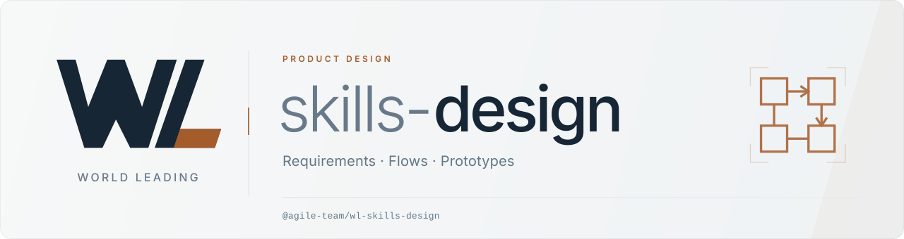

<p align="center">
  <picture>
    <source media="(prefers-color-scheme: dark)" srcset="https://raw.githubusercontent.com/ChenyCHENYU/wl-skills-design/main/assets/wl-design-logo-dark.svg">
    
  </picture>
</p>

<p align="center"><strong>把业务事实整理为相互对齐、可追溯、可机械校验的需求与设计交付物。</strong></p>

<p align="center">
  <a href="https://www.npmjs.com/package/@agile-team/wl-skills-design"></a>
  <a href="https://nodejs.org/"></a>
  <a href="LICENSE"></a>
</p>

[English](README.en.md)

**业务事实 → 流程与需求 → 数据库与接口 → 跨文档评审 → 修复复验 → 开发交接**

## 适用与能力

面向需求分析、产品设计、技术设计与设计评审。可从零开始，也可接收既有文档；独立使用，无需先安装其他 WL 包。当前项目范围护栏排除移动端。

| 设计任务 | 主要产物 | 检查重点 |
| --- | --- | --- |
| 梳理流程与页面 | draw.io 泳道图、原型标注 | 活动编码、角色、分支、布局和页面动作 |
| 编写需求说明书 | 分册说明书、按钮级 IPO 处理逻辑 | 输入输出、前置校验、状态变化与异常文案 |
| 设计数据库与接口 | ER、数据字典、DDL、接口定义 | 字段一致性、类型、索引、响应与错误码 |
| 接收半成品文档 | 差距报告、补全任务、待确认清单 | 结构缺口、术语与字典值漂移 |
| 评审与变更分析 | 问题清单、追溯矩阵、影响与复验顺序 | 需求、流程、数据、接口是否对应 |

规则包含 **[M] 机械检查**与 **[J] 语义判断**：CLI 执行已实现的机械项，Agent 辅助评审业务语义，负责人确认事实和交付结论。

**确认技能是否生效：**

- GPT、GLM 等模型由 Codex、Claude Code 或具体 VS Code 插件读取项目入口；模型名称本身不代表已加载技能。
- 先在实际项目根运行 `npx --no-install wl-skills-design doctor-host --host codex --json`，按实际宿主调整 `--host`；这是入口诊断，不能代替一次真实调用。
- 支持原生技能时可说：`$wl-skills-design 请在 <项目绝对路径> 中 <完整任务>`；不支持该语法时，让 Agent 先读取 `.agents/skills/wl-skills-design/SKILL.md`。
- 首条进度应展示真实 `notice.summary`（旧版 `notice`），交付用 `npx --no-install wl-skills-design status --run-id <runId> --json` 核对执行与待检查项；自动选择取决于宿主，不能据安装承诺每次隐式任务都会触发。

`doctor-host` 的 `discoveryCoverage` 会并列展示当前项目五包的安装版本、原生入口候选、需复核项与缺失入口。候选表示元数据可解析；本地修改、执行器版本、宿主加载和真实执行分别核验，未接入的兄弟包不会自动安装。

同时使用多个宿主时，在项目 `wlSkills.hosts` 或安装命令 `--hosts codex,claude,zcode` 中明确选择实际宿主；模型名不参与目录选择。五包各保留一个任务网关，具体 Skill 按需读取，不复制整套技能到每个编辑器。Qoder 使用 `.qoder/skills` 原生目录；Trae 当前仅核实规则引导和手动导入，不把 `.agents` 文件存在当作原生发现成功。

四个 MCP 服务会先显示简短中文调用回执，保留实际 `runId`、工具名与执行/验证状态；部分验证会说明未完成原因。机器调用方优先读取 `structuredContent`，兼容 JSON 保留在后续文本块，不再固定对 `content[0].text` 做 `JSON.parse`。仅工具返回、计划建立、检查通过分别展示；没有关联检查记录时明确说明。

ZCode 用户请使用 `--host zcode`，打开实际项目，在 Settings → Skills 刷新并核对启用；仍未出现时用新会话验证。ZCode 不会递归发现所有子项目，也不会合并子项目 AGENTS；不要为显示五包而复制同名入口。每包说明应把具体用途放在前 250 字符，超 1024 字符会被丢弃。显式选择和自然语言自动选择共用技能清单，自动选择还受元数据预算、当前 Agent 的工具开关与任务匹配影响。[官方技能说明](https://zcode.z.ai/en/docs/skill)

## 精简项目集成

默认 `compact`：规范、技能正文、模板、样例与适配器实现保留在 npm 包内，项目只生成所选宿主的必要入口和安装状态。默认使用通用 `.agents/skills`；Codex、ZCode、Kilo 等共用入口，不因发现 `.cursor` 等目录就自动增加适配。

```bash
npx --no-install wl-skills-design init --hosts codex,zcode,kilo
npx --no-install wl-skills-design update --integration compact --hosts codex --dry-run
```

宿主配置保存在已有 `package.json` 的 `wlSkills` 字段，无 npm 项目时使用 `.wl-skills/config.json`：`{"schemaVersion":1,"integration":"compact","hosts":["codex","zcode","kilo"]}`。`--hosts` 优先于兼容参数 `--editor`；`--hosts all` 和 `--integration expanded` 仅显式启用。Windsurf 旧规则不再默认生成，`windsurf` 选择兼容映射到 Devin 的通用入口。

`task` 返回可直接读取的真实资源路径，项目覆盖优先于当前执行包默认资源；没有复制到项目不再被误判为缺失。安装状态和运行证据位于 `.wl-skills/state/design/`，规则快照与业务输入分别记录。 `.wl-skills/state/.gitignore` 仅忽略各包的 runs/cache/backups，安装清单和项目配置仍可提交；共享忽略文件保留已有项目条目，不随单包卸载删除。升级读取旧归属清单，只清理未经修改的本包文件/区块；用户修改、项目契约、其他包内容、无法确认归属的旧备份保留。先用 `--dry-run` 核对变更；有冲突不产生半安装。旧版执行回执继续可读。

## 三步接入

在**实际目标项目根目录**执行，需要 Node.js 20+。接入负责人配置一次，后续直接向已加载规则的 Agent 描述设计任务。

### 1. 安装执行器与设计规则

```bash
npm install -D @agile-team/wl-skills-design
npx --no-install wl-skills-design init
```

默认使用 `AGENTS.md` 通用入口，Codex 原生入口位于 `.agents/skills/wl-skills-design/SKILL.md`。使用 Cursor 时，在 `init` 后加 `--editor cursor`；其他编辑器选项见 `--help`。

纯文档仓库也可用 `npx @agile-team/wl-skills-design init` 分发规则；持续校验与 CI 建议固定项目依赖和锁文件。

### 2. 核对接入结果

```bash
npx --no-install wl-skills-design doctor
npx --no-install wl-skills-design doctor-host --host codex --json
```

`doctor` 检查安装与 Skill 清单；`doctor-host` 检查入口和版本是否对齐。编辑器刷新规则后，还需在一次真实任务中看到工具判定和检查结果。

### 3. 给出一条具体任务

> 为 DEMO 设备点检模块生成需求说明书骨架。范围是点检单录入到归档，不含维修派工；目标是记录数字化、异常可追溯。先列缺失事实，再展开流程和按钮级 IPO。

最少给出**项目代号、模块范围、业务目标**就能起步。岗位、对象、状态、操作规则和技术画像逐步补齐；缺失业务事实标记“待补充”，不会靠猜测填完整。

首次反馈应包含适用 Skill / 规则、目标、`runId` 和待检查项。安装完成只说明资产已分发，真实任务反馈才能用于确认本次是否调用了工具。

## 一个场景：点检流程变更如何传到接口

“确认点检单”增加前置条件后，需要同时更新流程、按钮处理、状态字段和接口约束。

| 环节 | 如何处理 | 验收点 |
| --- | --- | --- |
| 先看影响 | 对 Agent 说“分析确认条件变化影响哪些设计文件” | 列出受影响文档、待确认事实和复验顺序 |
| 确认后修改 | 授权后补齐流程 / IPO / 数据 / 接口 | 使用相同业务编码、状态值与错误文案 |
| 脚本复验 | 分域运行 `verify` | 返回规则编号、实际检查文件和问题位置 |
| 跨文档评审 | 检查业务含义与追溯关系，回查 `status` | 机械问题、语义问题、未覆盖项分别列明 |

例如，复核已存在的接口文档，由 Agent 或 CI 使用同一任务编号执行：

```bash
npx --no-install wl-skills-design task --input "检查接口设计结构" --file docs/api/01-inspection.md --run-id inspection-review --json
npx --no-install wl-skills-design verify api --file docs/api/01-inspection.md --run-id inspection-review --json
npx --no-install wl-skills-design status --run-id inspection-review --json
```

授权修复后，用同一 `runId` 更新任务计划并再验，避免沿用修改前的检查结论。`status` 显示执行状态、检查范围、失效证据和待检查项；机械项通过仍可能是 `partial`，业务语义与最终图形渲染需要继续复核。

## 校验入口

| 产物 | 命令 |
| --- | --- |
| 需求说明书 | `npx --no-install wl-skills-design verify spec --target .` |
| 泳道流程图 | `npx --no-install wl-skills-design verify flowchart --file docs/flowchart/input.drawio` |
| 数据库设计 | `npx --no-install wl-skills-design verify db --target .` |
| 接口设计 | `npx --no-install wl-skills-design verify api --target .` |
| 可选设计模型 | `npx --no-install wl-skills-design validate-model --model docs/design-model.json` |

指定 `--file` 只检查该文件或目录，不借其他文件判通过。CI 调用同一 CLI，并归档输出与本次回执；跨文档评审不能被单文件检查替代。完整机械覆盖、未实现项和公开集成协议见[公开 API 与执行边界](docs/public-api.md)。

流程图文字过长时，`layout-flowchart --file <原图> --output <新图> --dry-run` 可预览自适应布局；正式执行输出新文件，随后运行流程图验证并检查实际渲染。

## 常用维护

| 需要做什么 | 命令 |
| --- | --- |
| 查看最近任务回执、受管文件与本地改动 | `npx --no-install wl-skills-design status` |
| 预检规则升级 | `npx --no-install wl-skills-design update --dry-run` |
| 对齐执行器与规则 | 更新依赖和锁文件，审阅后执行 `update` |
| 查看可恢复快照 | `npx --no-install wl-skills-design restore --list` |
| 预览卸载 | `npx --no-install wl-skills-design uninstall --dry-run` |

安装、升级和恢复按本包归属管理文件，保留用户及其他包内容；本地改动默认受保护。评审和影响分析默认只读，修改既有业务设计须在授权范围内执行。

## 深入使用

- [使用指南](files/.github/guides/usage.md)：创建、评审、修复与半成品接入。
- [输入准备清单](files/.github/guides/inputs-checklist.md)：从最小输入逐步补齐业务和技术事实。
- [设计模型](files/.github/guides/design-model.md)：需要跨文档稳定 ID 追溯时再启用。
- [项目范围](docs/project-scope.md) · [公开 API](docs/public-api.md) · [维护契约](docs/maintenance-contract.md)。

## WL · World Leading

六个包按职责独立使用，按需要组合；Design 产物可作为开发和测试输入，不强制安装兄弟包。

| 包 | 职责 |
| --- | --- |
| [skills-gate](https://github.com/ChenyCHENYU/wl-skills-gate) | 项目钩子、构建门禁与质量闭环编排 |
| [skills-kit](https://github.com/ChenyCHENYU/wl-skills-kit) | PC Vue 管理端开发规范与工程约束 |
| [skills-ui](https://github.com/ChenyCHENYU/wl-skills-ui) | 界面规范、布局与交互质量 |
| [skills-bd](https://github.com/ChenyCHENYU/wl-skills-bd) | Java 后端规范、契约与校验 |
| [skills-test](https://github.com/ChenyCHENYU/wl-skills-test) | 测试设计、执行、质量证据与交付 |
| **skills-design** | 需求、流程、数据库与接口设计 |

[Apache-2.0](LICENSE)
